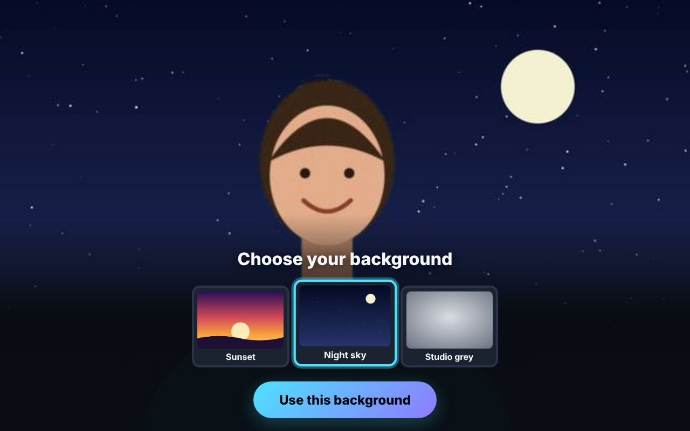
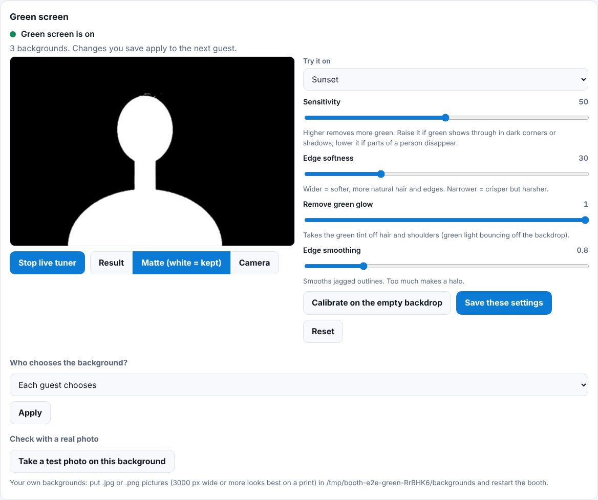
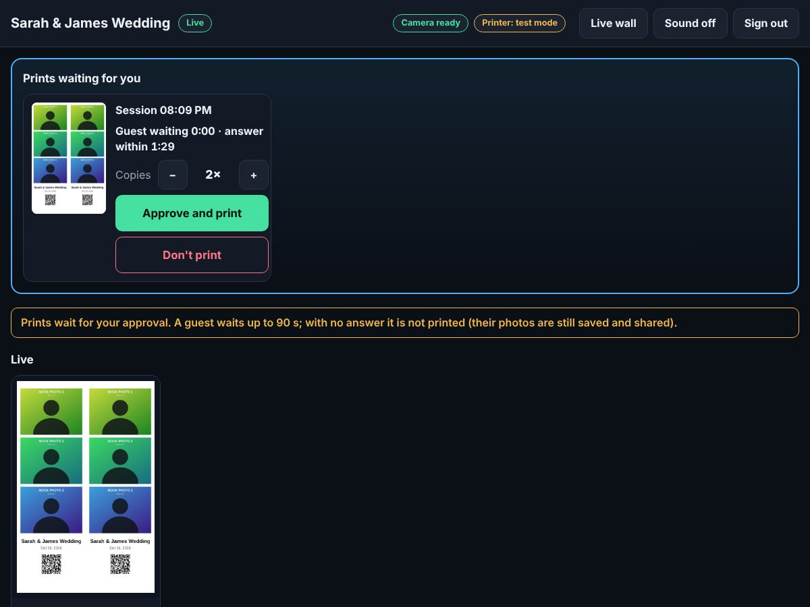
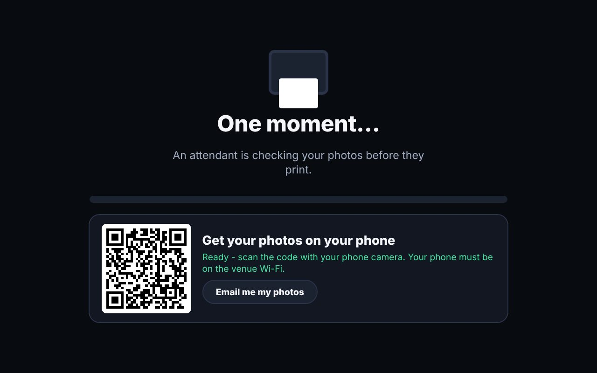
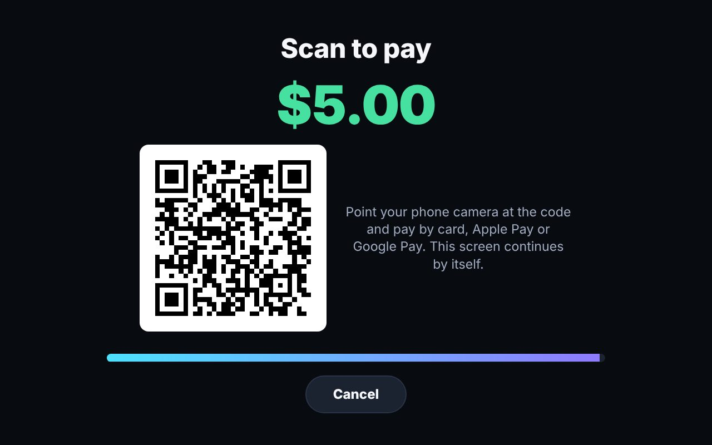
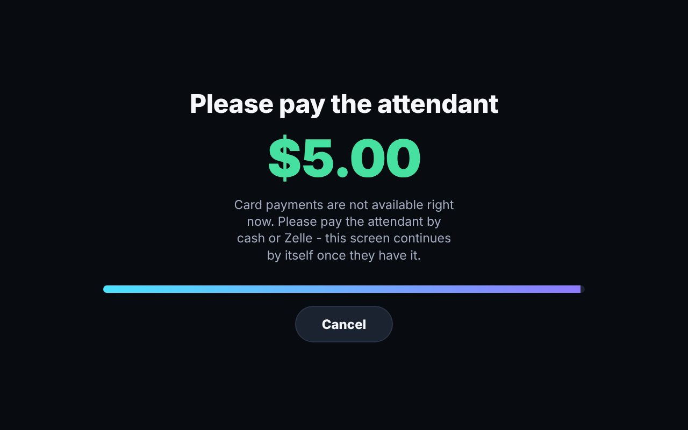

# Nexus Booth

A photobooth you run yourself: a touch-screen kiosk for guests, a DSLR for the photos, and a DNP printer for the prints.

```
guest taps  ->  countdown + live preview  ->  3 photos  ->  review / retake  ->  print  ->  thank you
```

On top of that it can take **payments** (guests pay by card on their phone, or an attendant takes cash/Zelle), put a **QR code** on every print and give each guest a private **online gallery**, **email** the photos, record a boomerang **GIF**, replace a **green screen** with a background the guest picks, and run an **attendant station** - a second screen that shows the booth live, **approves prints before they reach the printer**, and shares photos. Each is off until you switch it on in `config.json`; see the sections below.

It is a small local web app. A Node server drives the camera (through [digiCamControl](https://digicamcontrol.com), a free Windows program), builds the print layout, and sends it to the Windows print queue. The guest screen is just a browser in full-screen kiosk mode.

> **Read "[What has and hasn't been verified](#what-has-and-hasnt-been-verified)" before relying on this at a paid event.** The software is tested end to end, but the real DSLR and DNP printer paths could not be exercised outside your hardware.

## Try it in two minutes (no camera or printer needed)

Needs [Node.js 22 LTS](https://nodejs.org).

```bat
cd photobooth
npm install
copy config.example.json config.json     (macOS/Linux: cp config.example.json config.json)
npm start
```

Open <http://127.0.0.1:3000>. This uses a **mock camera** (synthetic photos) and **dry-run printing** (print PDFs are saved, nothing is printed), so you can rehearse the whole guest flow, the error screens and the operator panel.

Operator panel: tap the **top-left corner of the start screen 5 times**, or open `/operator.html`. Default PIN `1234` (change it).


## Set up your Windows booth PC

1. **Install Node.js 22 LTS.**
2. **Install digiCamControl** and plug in the DSLR over USB. Confirm that digiCamControl itself sees the camera and can take a photo before involving the booth.
3. **Turn on digiCamControl's web server** and allow it to run actions (its settings have a *Webserver* section; it is off by default, default port `5513`). Check it works: open `http://127.0.0.1:5513/?slc=list&param1=cameras` in a browser. You should see your camera's serial number. A web page instead of a serial number means actions are not enabled.
4. **Camera settings:** image quality **JPEG Large/Fine** (RAW-only is rejected with a clear message), turn **auto power-off/sleep off**, use an **AC adapter / dummy battery**, set a fixed exposure that suits your lighting/flash.
5. **DNP printer:** install the Windows driver and print a Windows test page. Then run `npm run printers` to list the exact **printer name** and the exact **paper size names** the driver offers. For photo strips use the driver's **2-inch cut / 2x6** size.
6. **Config:** `copy config.hardware.example.json config.json`, then edit `printer.name`, `printer.paperSize`, `operatorPin` and, if you like, `storage.dir`. Use a path **without spaces** such as `C:\booth\events`.
7. `npm install --omit=dev`, then double-click **`scripts\start-booth.bat`**. It starts the server and opens the guest screen full-screen in Chrome (or Edge). Put a shortcut to it in `shell:startup` to launch with Windows.

Leave kiosk mode with **Alt+F4**. To stop the booth, close the minimised "Nexus Booth server" window.

## Before every paid event: the checklist

Do this at home, with paper loaded, on the exact PC, camera and printer you will use. None of it can be done for you.

- [ ] Operator panel shows **Camera ready** and **Printer ready**, and no warnings you do not understand.
- [ ] **Take test photo** works and the picture is sharp and well exposed.
- [ ] **Print test page**: the red border is fully visible (nothing cropped), and the colour swatches look right.
- [ ] Run **3 full guest sessions** with the real layout. Check: the footer text renders, the strip cut falls *between* the two strips and does not slice a photo, the prints are the right way up.
- [ ] **Unplug the camera** mid-countdown. The guest should see the plain error screen, not a frozen page. Plug it back in and confirm "Try again" recovers.
- [ ] **Take the paper out** and run a session. Note what your printer does, because the booth cannot tell (see limitations). Know how you will notice a printer problem at the event.
- [ ] **Reboot the PC**, run `start-booth.bat` and confirm it comes up on its own.
- [ ] Run **20+ sessions back to back** and check nothing slows down or leaks.
- [ ] Change `operatorPin` and write the PIN down somewhere other than the booth.
- [ ] **If you use sharing/email:** scan a **printed** QR code with a real phone, and send yourself a real email to a Gmail *and* an Outlook address (check the spam folder).
- [ ] **If you use green screen:** with your real backdrop and lights, run the tuner's **Calibrate**, check the **Matte** view with a person in front, and run a test photo. Try dark clothes, white clothes and fine hair.
- [ ] **If you take payments:** in **test mode**, pay with the test card on a real phone from the kiosk screen; unplug the internet and check the guest is asked to pay the attendant; cancel a payment; refuse a print and refund it. Then, with the live key, make one real $0.50 payment and refund it, and check it appears in `payments.csv` and in your Stripe dashboard.
- [ ] **If you use the station:** open it on the real attendant device over the real network, approve a print and reject one, then close its page and check what a guest sees. Decide what `onTimeout` should be if you step away.

## Running an event

- **Operator panel** (`/operator.html`, PIN): live camera/printer status, test photo, test print, recent print jobs, event settings, and recent sessions with a **Reprint** button.
- Change the **event name** there at the start of each event. It starts a new photo folder (`2026-10-16-sarah-james-wedding`) so events never mix.
- **Where the photos are:** `events/<event>/<session>/` holds `originals/` (the untouched camera files, including retakes), `final.jpg` (the print-resolution picture), `print.pdf` and `session.json`. Copy the whole `events` folder off at the end of the night.
- **Logs:** `logs/booth.log`.

## Layouts

| id | Photos | Output |
|---|---|---|
| `strip-2x6-x2` (default) | 3 | A 4x6 sheet holding **two identical 2x6 strips**. Use the printer's 2-inch-cut size and it cuts them apart. |
| `single-4x6` | 1 | One full-bleed 4x6 photo. |
| `duo-4x6` | 2 | Two photos stacked on a 4x6 portrait print. |

Switch layouts in the operator panel. **Your own layouts** are plain JSON in `templates/` (a file with a built-in id replaces that built-in). A branded layout is usually a PNG designed in Canva/Photoshop with **transparent windows where the photos show through**; the booth puts the photos underneath it.

```json
{
  "id": "wedding-strip",
  "name": "Wedding strip",
  "shots": 3,
  "canvas": { "width": 1200, "height": 1800, "dpi": 300, "background": "#ffffff" },
  "slots": [
    { "shot": 0, "x": 30,  "y": 40,  "width": 540, "height": 405 },
    { "shot": 1, "x": 30,  "y": 469, "width": 540, "height": 405 },
    { "shot": 2, "x": 30,  "y": 898, "width": 540, "height": 405 },
    { "shot": 0, "x": 630, "y": 40,  "width": 540, "height": 405 },
    { "shot": 1, "x": 630, "y": 469, "width": 540, "height": 405 },
    { "shot": 2, "x": 630, "y": 898, "width": 540, "height": 405 }
  ],
  "overlay": "wedding-strip.png",
  "text": [
    { "text": "{event}", "x": 300, "y": 1540, "size": 58, "weight": 700, "color": "#111111", "anchor": "middle", "maxWidth": 540 }
  ]
}
```

`overlay` is a PNG in `templates/` with exactly the canvas size. `{event}`, `{date}` and `{time}` are filled in. A layout with a mistake (a slot off the canvas, a photo no slot uses, a missing overlay) is skipped at startup with the reason shown in the operator panel; it never takes the booth down. Landscape canvases are rotated to fit the portrait-fed 4x6 sheet.

## Sharing: QR codes and guest galleries

Turn on `sharing.enabled` and every guest gets a **private web page with their photos**. A QR code for it appears on the screen while the print comes out (and stays on the thank-you screen), and is **printed on the photo** (on each strip, so both halves work after the 2-inch cut). Phones need no app.

| | `local` | `upload` |
|---|---|---|
| Where the gallery lives | on the booth PC | on your web host (see [`webhost/README.md`](webhost/README.md)) |
| Guest's phone needs | to be on the **same Wi-Fi** as the PC | normal mobile data or any Wi-Fi |
| Internet at the venue | not needed | **needed** (uploads queue and retry if it drops) |
| Best for | an event where you provide the Wi-Fi | most events |

```json
"sharing": { "enabled": true, "mode": "local", "wifiHint": "Join the Wi-Fi network NexusGuests first." }
```

**Local mode caveats.** Windows will ask to allow the booth through its firewall the first time (allow *Private* networks). Many venue and hotel Wi-Fi networks use *client isolation*, which stops phones from reaching your PC at all; bring your own router, or use `upload` mode. Only the galleries are exposed on the network (port `lan.port`, default 3001); the camera, printer and operator controls stay on this PC only.

**Upload mode caveats.** The QR printed on a photo points at your web host, so if the venue has no internet it will not open until the PC reconnects and the queue catches up (the operator panel shows what is waiting). Always test with real mobile data.

## Email: send the photos to the guest's inbox

With `email.enabled`, the QR panel gets an **Email me my photos** button. The guest types their address on a built-in touch keyboard (no physical keyboard needed), the booth asks "Did you mean ...@gmail.com?" for common typos, and the email goes out **as soon as their gallery link is live**: never before, so nobody receives a link that does not open yet. The email has the link, a button and a small preview of the photos. It needs `sharing` turned on, because it contains that link.

```json
"email": {
  "enabled": true,
  "from": "Nexus Booth <booth@yourdomain.com>",
  "smtp": { "host": "smtp.hostinger.com", "port": 465, "secure": true, "user": "booth@yourdomain.com" }
}
```

Set the mailbox password as the environment variable **`BOOTH_SMTP_PASS`** so it is not in a file. Create a mailbox on your own domain for this (the host and port above are typical for Hostinger; confirm them in your hosting panel). In the operator panel's **Email** card, press **Check mail login**, then **Send test email** to your own address, before every event.

**Privacy, by design**
- The address is used **only to send the photos**. Once sent it is erased from disk; only a salted hash is kept for 24 hours (for the limits below). Addresses never appear in logs or in the operator panel in full (`j***@gmail.com`).
- Marketing is **opt-in only**: with `email.marketingOptIn.enabled` a tick-box (unticked) appears, and only addresses of guests who ticked it are saved, to `optin-emails.csv` in the event folder. The rules about marketing emails differ by country (for example GDPR, CAN-SPAM, CASL), so get proper advice before using that list.
- The kiosk cannot be used to spam: up to `maxPerSession` addresses per guest, `maxPerAddressPerHour` per address, repeats ignored.
- If sending fails because the venue connection is down, it keeps retrying (and survives a reboot) for `maxAgeHours`; a refused address or a wrong login fails at once and shows in the Email card with the reason, with **Retry** and **Dismiss**.

Deliverability matters more than code here: send from a mailbox on your own domain, make sure your host has SPF/DKIM set up for it, and test with real Gmail and Outlook addresses (and check their spam folders). Shared hosting plans also limit how many emails you may send per hour; check your plan.

## GIF

With `gif.enabled`, after the photos the booth shows a short **"Bonus: a GIF!"** countdown and records a few frames from the camera's live view, then plays them forwards and backwards (a "boomerang") as an animated GIF. It goes into the guest's online gallery and the QR/email link; it is **not printed**. It is an extra: if it cannot be recorded (live view not running, a frozen live view) the guest simply carries on to the review and the operator log says why.

```json
"gif": { "enabled": true, "frames": 8, "intervalMs": 250, "countdownSeconds": 2, "width": 640, "boomerang": true }
```

Quality note: the frames come from **live view**, not full-resolution photos (a DSLR cannot shoot stills that fast), so a GIF is screen-sized (a Canon's live view is roughly 960 x 640). It needs live view, so `camera.digicamcontrol.liveView` must be `true`. Because it also needs the camera free, a GIF is never recorded while a photo is being taken.

## Green screen

With `greenScreen.enabled`, guests stand in front of a green backdrop and **choose a background** - a beach, the night sky, your event's artwork - while watching themselves on it live. The photos, the live preview, the GIF, the print and the online gallery all show the new background. The camera's **original photo is never changed** (it keeps its green), so you can always re-key it later.

```json
"greenScreen": { "enabled": true, "defaultBackdrop": "guest" }
```



1. Put your own backgrounds (`.jpg` / `.png`, **3000 px wide or more** for a sharp print; at least 400) in the `backgrounds` folder next to the app, or leave `builtinBackgrounds` on to use the three included ones (Sunset, Night sky, Studio grey). Restart the booth after adding pictures. A picture that cannot be used (too small, damaged) is skipped and the reason is in the log.
2. Open the operator panel, **Green screen** card, and press **Start live tuner**. You see the camera with the background in place. Switch to **Matte** to see exactly what is kept (white) and what is replaced (black).
3. With **nobody in front of the backdrop**, press **Calibrate on the empty backdrop**: the booth measures how green it really is and suggests settings. Then stand in front yourself, adjust the sliders, **Save**, and use **Take a test photo on this background** as the final check.
4. **Who chooses?** *Each guest chooses* shows a picker after "Touch to start", with the guest live on each background. *Everyone gets: ...* fixes one background (and skips the picker) - handy for a themed event. A guest who walks away from the picker is returned to the start screen after `greenScreen.pickSeconds`.



**The setup matters more than the settings.** Software can only remove green that is *evenly and strongly* green:

- Use a **matte** chroma-key green sheet, paint or fabric. Stretch it flat: wrinkles make shadows, and shadows are the darker, weaker green that leaks through.
- Light the **backdrop separately and evenly** (two lights at its sides), and light the guest from the front. Do not rely on the guest's lights to light the backdrop.
- Stand guests **1.5-2 m in front of the backdrop**. Closer, and green light bounces onto their hair and shoulders ("spill"). The **Remove green glow** setting repairs some of it, not a lot.
- **No green clothes, jewellery or props**: anything that is green is removed with the backdrop, and light-green things partly vanish. Shiny, white or very light clothes pick up the most glow; fine flyaway hair is the hardest edge.
- Set the camera to **manual exposure and white balance**, so the green does not change from photo to photo (and settings you tuned stay right). Keep JPEG Large/Fine.

How it works, in one line: each pixel is judged by *how much greener it is than its red and blue*; skin, hair and most clothes are not green at all, the backdrop very much so, and a soft zone in between gives natural edges. It runs on the picture already reduced to the size it is shown or printed at (a 24-megapixel original is never processed in full), so the keying itself takes about 7 ms for a live frame and about 50 ms for a print-size photo (measured on a 4-core test machine; decoding and saving add to that). Each session **remembers the settings it began with**, so a retune during an event never makes one guest's photos inconsistent; the next guest gets the new settings.

Rehearsing without a green screen: set `camera.mock.scene` to `"greenscreen"` (with the mock camera) and the booth films a simulated person in front of an unevenly lit, noisy green backdrop.

## Attendant station: live view, print approval, sharing

A second screen - an attendant's PC or tablet on the same network - that shows the booth **live** and does the jobs a person is better at than a kiosk:

- **Live feed:** every session appears as the guest starts, each photo arrives as it is taken, then the finished layout, with its print state (waiting for approval / printing / sent to the printer / not printed) and whether the guest's link is ready. Camera, printer, failed prints, failed emails and failed uploads are shown as badges at the top.
- **Print approval:** with `station.approval.enabled`, a guest's "Print my photos" waits for you. You see the finished picture, choose the number of copies, and tap **Approve and print** or **Don't print** (or **Approve all** at a busy moment). The guest sees "An attendant is checking your photos" and meanwhile can already scan their QR code. **Reprints and test prints by staff never wait.**
- **Share:** per session, show the guest a QR code on the station, or type their email address (same address checks, spam limits and privacy rules as the kiosk).
- **Live wall:** a fullscreen slideshow of the finished photos for a venue screen (open the station on that screen and press *Live wall*; new photos jump to the front).

```json
"station": { "enabled": true, "pin": "pick-a-pin", "approval": { "enabled": true, "timeoutSeconds": 120, "onTimeout": "cancel" } }
```




1. Set `station.enabled` and a `station.pin` of **at least 6 characters** (better: the `BOOTH_STATION_PIN` environment variable). Make it different from `operatorPin`.
2. Start the booth. The log, and the operator panel's **Attendant station** card, show the address: `http://<this PC's address>:3001/station/`. Open it on the attendant's device and sign in. The first time, Windows may ask to allow the booth through its firewall: allow it on **private** networks.
3. The operator card also has a switch to turn approval on and off during the event.

**What happens when nobody answers.** A guest never waits for ever. After `timeoutSeconds` the request is settled by `onTimeout`: `"cancel"` (default) means it is not printed - the guest is told, and their photos are still saved and shared by QR/email - and `"print"` means it is printed anyway. If **no station is connected** when the guest taps print (the station's page must be open and signed in), nobody is asked and the request is settled at once the same way, so a guest is never made to wait for nothing. If you are unattended, switch approval off in the operator panel, or set `onTimeout` to `"print"`.

**Security, honestly.** The station is the only part of the booth, besides the guests' galleries, reachable over the network (`lan.port`); the guest kiosk, operator panel and camera controls stay on this PC (`127.0.0.1`) and are not reachable from it. The station needs the PIN: wrong PINs are slowed down and five in a row lock sign-in for a minute; a sign-in is a signed cookie (HttpOnly, SameSite=Strict, 12 hours, revoked on sign-out); changes from other websites are refused; and the station can only fetch screen-size pictures - never the camera originals, print files or the share links file. **But the booth speaks plain `http`** (a self-signed certificate would make every browser warn), so the PIN and pictures cross your network unencrypted. Use a private network (your own router or phone hotspot), not a public or guest Wi-Fi.

## Payments: guests pay for prints or sessions

Off by default: the host pays and guests are never charged. Switch it on when guests should pay, **per print** (they pay at the Print button, after seeing their photos; QR/email sharing stays free) or **per session** (they pay once, before the photos, and that includes the print). Prices are in **US dollars** and can be changed during the event in the operator panel's **Payments** card, as can *who pays* (so a host-paid event and a guest-paid event use the same booth).



**How a guest pays**

- **Stripe (card, Apple Pay, Google Pay):** the kiosk shows the amount and a QR code; the guest scans it with their phone and pays on Stripe's own page. Card details never touch this PC. The booth then asks Stripe whether it was paid (it checks every couple of seconds; no inbound connection to your PC is needed, which is what makes it work behind a mobile hotspot) and continues by itself.
- **Attendant (cash, Zelle, Venmo...):** with `payments.provider: "attendant"`, or whenever cards cannot be reached, the kiosk says "Please pay the attendant", and the attendant taps **Mark paid** (choosing how they were paid) at the station or in the operator panel. The booth cannot check that cash or a Zelle transfer really arrived: that part is on trust and on your bank app. U.S. Bank lists Zelle for business as a way to accept payments without any hardware (check their fees and limits).



**Setting up Stripe** (about 20 minutes, none of which I could do for you):

1. Open a Stripe account and give it your business details; add your **U.S. Bank business checking account** as the payout account. You do not need a card terminal. Stripe starts in **test mode**, with fake cards and no real money.
2. Create a **restricted API key** (Developers > API keys) that may write *Checkout Sessions* and *Charges and Refunds* and read *PaymentIntents*. I could not check Stripe's dashboard from here: if a feature fails with a permission message, add the permission it names. A restricted key is safer than the full secret key because a leaked one cannot, for example, move your money.
3. Give the key to the booth as the **`BOOTH_STRIPE_KEY` environment variable** (Windows: `setx BOOTH_STRIPE_KEY rk_test_...`, then restart the booth). Do not put it in `config.json` and never paste it into a chat, an email or a screenshot.
4. Upload `webhost/paid.html` to your web host and set `payments.stripe.returnUrl` to its address (the page a guest's phone shows after paying).
5. Set `payments.enabled`, `payments.mode` (`"print"` or `"session"`) and the prices, start the booth, and press **Check the payment service** in the operator panel. The card shows **TEST** or **LIVE**.
6. Rehearse with Stripe's test card `4242 4242 4242 4242` (any future date, any CVC). When the checklist below is done, switch to the live key.

```json
"payments": { "enabled": true, "mode": "print", "pricePerPrintCents": 500, "pricePerSessionCents": 1000, "stripe": { "returnUrl": "https://example.com/booth/paid.html" } }
```

**Why Stripe and not U.S. Bank's own processing:** U.S. Bank's card processing is run by Elavon. Their online route is a hosted payment page that you apply for through a banker, and I found no published way for a booth to start a payment and then check its result without a public web address, which a hotspot cannot give. The payment code is built so another service can be added (it only needs "start a payment", "was it paid?", "close it" and "refund"), but that needs Elavon's developer documentation and credentials, which I do not have. Stripe pays out to your U.S. Bank account, so the money still lands there.

**When there is no internet.** A card payment needs internet at the booth PC (the hotspot) *and* mobile data on the guest's phone; nothing can change that. So the booth **never stops**: when it cannot start a card payment, `payments.offline` decides. `"attendant"` (default): the guest is asked to pay the attendant, and the attendant confirms it; `"free"`: the guest goes through without paying (and the ledger records "waived"), which keeps the line moving but gives away prints. If the connection drops *after* a guest has paid, the booth keeps asking Stripe, and a payment that arrives late is caught, flagged "paid after the screen timed out", and left for you to refund or honour.

**When something goes wrong after a guest paid.** The booth never decides about money by itself: it flags the payment and a person chooses, at the station (or the operator panel): **Print it anyway**, **Refund** (a card goes back through Stripe, cash is recorded as handed back) or **Dismiss**. It flags: a print the attendant did not approve (or nobody approved in time, or the guest left), a print job that failed at the printer, a payment that arrived after its screen timed out, and a session that could not start. Unused paid sessions older than two minutes are listed too. One payment can only ever buy one print or one session, even if the guest taps twice or two screens ask at once. A guest who cancels, or runs out of time, gets nothing charged: the payment page is closed at Stripe so it cannot be paid afterwards.

**Your records.** Every payment, waiver and refund is also appended to `payments.csv` in the event folder (time, payment id, session id, amount, method, how it was paid, Stripe reference): plain text for your bookkeeping, with no card details and no names. The operator panel and the station show this event's takings. It is a record, not accounting software.

**Things payments do not do:** add **sales tax** (include it in your prices; tax rules for photo services vary, so ask your accountant), send receipts, take tips, or apply discounts and codes. Stripe's fee (typically about 2.9% + 30 cents per US card payment; check their pricing page) comes off each payment, so small prints cost you proportionally more than a session fee; Stripe will not take a card payment under 50 cents. Disputes and chargebacks are handled in the Stripe dashboard.

## Configuration

`config.json` is merged over the defaults in `server/config.js`; only the keys you set are needed. A typo is reported at startup, naming the setting, instead of failing at the event.

| Key | Meaning |
|---|---|
| `port`, `host` | Where the booth listens. `host` stays `127.0.0.1` so only this PC can reach it. |
| `operatorPin` | PIN for the operator panel. Change it. |
| `event.name` | Shown on the start screen and printed on the photos. |
| `activeTemplate` | Layout id (can be changed live in the operator panel). |
| `camera.driver` | `mock` or `digicamcontrol`. |
| `camera.digicamcontrol.*` | `baseUrl`, timeouts, `liveView`, `stopLiveViewForCapture` (most DSLRs cannot shoot full-resolution while live view runs). |
| `printer.mode` | `dryrun` (PDF only) or `windows` (real printing). |
| `printer.name` | Exact Windows printer name. **Required** for `windows` mode: the booth never falls back to your default printer. |
| `printer.paperSize` | Exact driver paper-size name, or empty to use the driver's own settings. |
| `printer.copies`, `enabled`, `autoPrint` | Copies per guest, printing on/off, print automatically when the review timer ends. |
| `ui.*` | Countdown length, how long each screen stays, retakes, mirrored preview, flash. |
| `storage.dir` | Where events are saved. |
| `sharing.enabled`, `sharing.mode` | Guest galleries and QR codes: `local` (served by this PC) or `upload` (your web host). |
| `sharing.publicBaseUrl` | The address phones use. Upload mode: `https://yourdomain.com/booth`. Local mode: leave empty to use this PC's network address. |
| `sharing.autoUpload`, `sharing.qrOnPrint` | Upload every session right away (needed for the printed QR to work); print a QR on layouts that have room. |
| `sharing.wifiHint`, `sharing.shareSeconds` | Text under the QR in local mode; how long the QR stays on the thank-you screen. |
| `sharing.upload.url`, `sharing.upload.secret` | Web host receiver address and shared secret (set the secret with the `BOOTH_UPLOAD_SECRET` environment variable). |
| `gif.enabled`, `gif.frames`, `gif.intervalMs` | Record a boomerang GIF from live view after the photos: how many frames, and the gap between them in milliseconds. |
| `gif.width`, `gif.countdownSeconds`, `gif.boomerang` | GIF width in pixels (never enlarged), the "get ready" countdown, and whether it plays forwards then backwards. |
| `greenScreen.enabled` | Replace a green backdrop with a background the guest picks. |
| `greenScreen.dir`, `greenScreen.builtinBackgrounds` | Folder with your own `.jpg`/`.png` backgrounds; whether to include the three built-in ones. |
| `greenScreen.defaultBackdrop` | `"guest"` (each guest chooses) or a background id such as `"builtin-night"` (everyone gets it). Also switchable in the operator panel. |
| `greenScreen.pickSeconds`, `greenScreen.previewWidth` | Idle time before the picker returns to the start screen; width in pixels of the live keyed preview (lower = smoother on a slow PC). |
| `greenScreen.key.*` | `sensitivity`, `softness`, `despill`, `edgeBlur`. Best set from the operator panel's tuner, which saves them. |
| `camera.mock.scene` | Mock camera only: `"portrait"` or `"greenscreen"` (a person in front of a green backdrop, for rehearsal). |
| `station.enabled`, `station.pin` | The attendant's station (live view, print approval, sharing, live wall) on the network port. The PIN is required, at least 6 characters; set it with `BOOTH_STATION_PIN`. |
| `station.approval.enabled` | Every print waits for the station's approval (also a switch in the operator panel). |
| `station.approval.timeoutSeconds`, `onTimeout`, `maxCopies` | How long a guest waits; what happens when nobody answers (`"cancel"` or `"print"`); the most copies the station can choose. |
| `station.recentSessions` | How many recent sessions the station shows. |
| `payments.enabled`, `payments.mode` | Let guests pay: `"print"` (per print), `"session"` (once, before the photos) or `"off"` (the host pays). Also switchable in the operator panel. |
| `payments.provider` | `"stripe"` (QR code, card/Apple Pay/Google Pay) or `"attendant"` (a person confirms cash/Zelle). |
| `payments.pricePerPrintCents`, `pricePerSessionCents` | Prices in whole US cents (`500` = $5.00; at least 50). A print price is per copy. Changeable live in the operator panel. |
| `payments.timeoutSeconds`, `payments.offline` | How long a guest has to pay; what to do when cards cannot be reached: `"attendant"` (default) or `"free"`. |
| `payments.stripe.returnUrl`, `payments.stripe.secretKey` | The page a guest's phone shows after paying (`webhost/paid.html`); the Stripe key (set it with `BOOTH_STRIPE_KEY`, preferably a restricted key). |
| `email.enabled`, `email.from`, `email.smtp.*` | Let guests email themselves their photos. Needs `sharing.enabled`. Set the password with `BOOTH_SMTP_PASS`. |
| `email.subject`, `email.intro` | Subject (`{event}` is replaced) and opening line of the email. |
| `email.marketingOptIn` | `{ "enabled": true, "label": "..." }` adds an unticked tick-box; only ticked addresses are kept. |
| `email.maxPerSession`, `maxPerAddressPerHour`, `maxAgeHours` | Anti-spam limits and how long to keep retrying. |
| `lan.host`, `lan.port` | The small network listener for galleries (default port 3001). Nothing else is exposed. |

## What has and hasn't been verified

**Verified, automatically, outside any hardware** (`npm test`, `npm run e2e`):

- Configuration, layout validation and pixel-level compositing (each photo lands in the right slot of both strips, EXIF rotation, overlays, text fitting).
- The print PDF is exactly 4x6 inches; landscape layouts rotate correctly.
- The whole HTTP API: guest journey, retakes, camera failure, a busy camera, operator PIN, settings, reprint.
- The guest and operator screens in a real browser (landscape and portrait), including the error screen and recovery.
- The digiCamControl adapter against a stand-in server that follows digiCamControl's own source code: command format, `OK`-vs-error replies, RAW rejection, timeouts, live view pause/resume.
- The Windows printing adapter against a stand-in for `pdf-to-printer`.
- Sharing: QR codes decoded back to the exact link, including a 0.6-inch code on a JPEG-compressed strip, each strip half after the cut, and the code shown on the kiosk screen opened in a phone-sized browser.
- GIFs: encoded for real and decoded back with an independent reader (frame count, order, boomerang, size, timing, looping, colour fidelity); frozen or missing live view is handled; the web-host receiver accepts the GIFs byte for byte.
- Green screen: the keyer is judged against synthetic footage with **known ground truth** (a noisy, unevenly lit backdrop with a shadow and dark corners; a person in skin, dark hair and a blue top): 99.5%+ of the backdrop is replaced and the interior of the person comes out unchanged; harsher lighting needs a higher sensitivity and the tests prove the setting does that; green glow on hair is removed; keying measured at ~7 ms for a live frame and ~50 ms for a print-size slot. Plus rotation, mirroring (only the person), calibration, the backgrounds loader, keyed photo previews, **the finished print**, GIF frames and the guest gallery, the live keyed stream, the operator tuner, and per-session settings - and the picker and tuner in a real browser.
- The station: sign-in (wrong PIN slowdown, lockout, tampered/expired/revoked cookies, cross-site requests refused), that every route needs the cookie and that the guest kiosk, operator panel and camera are **not** reachable on the network port, that only screen-size pictures can be fetched (originals, print PDFs, `session.json` and path tricks are refused), the live feed (a session appearing, each photo, the finished picture, the link, the print state), and the whole approval life cycle against a real booth: approve with copies, reject, nobody answers (both `onTimeout` settings), no station connected, a guest who leaves, a double tap, two simultaneous approvals (printed once), approve all, switching approval off, reprints by staff, QR and email from the station. The station page, the kiosk's waiting screen and the whole approval round trip run in two real browsers.
- Payments, against a **fake Stripe that follows Stripe's documented behaviour** (Checkout Sessions, polling, expiring a page, refunds with idempotency keys, key errors): the exact amount and a QR code that decodes to the payment page; nothing prints (or opens a session) without a paid, unused payment for that guest; one payment can never buy two things, even with simultaneous taps; the printed copies are what was paid for; cancelling closes the payment page; **no internet** falls back to the attendant (or free), and a payment that arrives after a timeout is caught and flagged; a paid-but-refused or failed print is flagged and can be refunded or honoured; refunds are made once; the ledger; prices and mode are validated and saved; the key never appears in the status, the redacted configuration or error messages. The whole flow (QR, attendant, cancel, refund, per-session) runs in real browsers.
- Email against a **real SMTP server**: the message (link, inline preview, escaped text, no header injection), waiting for the link to go live, temporary vs permanent refusals, a wrong login, a dead connection, restart recovery, rate limits, and that no readable address stays on disk or in logs. The touch-keyboard flow (typo suggestion included) runs in a real browser.
- The gallery listener exposes only galleries (the booth's API, operator panel and session folders are all unreachable from it).
- The web-host receiver (`webhost/upload.php`) running under **real PHP**: bad signatures, stale timestamps, path tricks, scripts disguised as images and oversized files are all refused; the queue retries, survives a restart and never publishes a gallery before its pictures.

**NOT verified: needs your hardware, so do the checklist above:**

- A real DSLR through a real digiCamControl: capture, live view, and live-view resume after each shot. The adapter mirrors digiCamControl's source, not a running copy.
- Real printing to a DNP printer, including the exact paper-size names and the 2-inch cut.
- Footer text rendering on Windows (it uses system fonts; a transparent PNG overlay with the text baked in avoids this entirely).
- `start-booth.bat` and kiosk mode on a real Windows PC.
- Scanning a **printed** QR with a real phone camera on DNP paper (decoding was tested on the digital picture with an independent QR reader).
- GIF **quality** from a real Canon live view (frame rate and resolution depend on your camera, lens and lighting; only the encoder and the recording logic were tested, with synthetic frames).
- Email **deliverability**: whether Hostinger's (or any) SMTP server accepts the messages, whether Gmail/Outlook put them in spam, your hourly sending limit, and how the HTML email looks in real mail apps (only the message content and delivery to a test server were checked).
- Green screen on **real footage**: a real green sheet, your lights and a real Canon's noise, colour and live-view quality. The keyer is tested on simulated footage, which is cleaner and more regular than a real backdrop, so expect to spend ten minutes with the tuner. The live keyed preview's frame rate and delay on your PC and camera are also unmeasured (only the mock camera was used).
- The station on **your** devices and network: Windows firewall prompt, client isolation on venue Wi-Fi, how the page looks on your tablet, and that an attendant notices a new print request (a sound can be switched on, but browsers only allow sound after a tap on the page, and a locked tablet may sleep the page).
- **Stripe itself.** The fake follows Stripe's documentation, not a real account. Not checked: Stripe's real payment page and the QR scan from your kiosk screen under venue lighting, Apple Pay / Google Pay, that your restricted key has the right permissions, real refunds, payouts to your U.S. Bank account, and how Stripe behaves from a hotspot. Do this in test mode first, then make one real $0.50 payment and refund it before your first paid event.
- **Cash and Zelle confirmations** are trust-based: the booth cannot see your bank or your cash drawer.
- Typing comfort on your real touch screen size (the keyboard is sized for screens from about 600 px tall up).
- Local mode on a real venue network (Windows firewall prompt, client isolation, the phone actually reaching the PC).
- The web host's `.htaccess` rules (hiding `config.php`, blocking folder listings) and the host's own PHP settings; only the PHP script itself was tested. See the checks in `webhost/README.md`.

**Known limitations**

- **The booth cannot see printer problems.** "Done" means the job was handed to the Windows print queue. Out of paper, no ribbon or a jam are not reported back, so a guest can be told "sent to the printer" while nothing prints. Watch the printer and the Windows print queue.
- One camera, one photo at a time.
- Pausing live view around each shot adds a second or two before the preview returns.
- Green screen cannot tell a green garment from the backdrop, and fine hair against an unevenly lit backdrop will look rougher than against a well-lit one (see the setup advice above).
- **Print approval is not a guarantee against waste**: it protects the printer from prints nobody checked, but the booth still cannot see an empty paper tray (above). Pending requests live in memory: restarting the booth while a guest waits sends that guest to the error screen.
- The station uses plain `http` on your network (see its security note); the live wall shows every finished photo to whoever can see that screen, so only use it where guests know their photos are displayed.
- **Card payments cannot work offline** (see Payments). Pending payments do not survive a booth restart as "waiting guests": a restart closes any open payment page (or finds it paid and flags it for you), and a guest at the kiosk starts again.
- Payments are US dollars only, with no tax, tips, discounts or receipts. Prices are per copy / per session.
- Not included yet: SMS sharing, multiple printers, other payment services (U.S. Bank/Elavon needs their developer access).

## Troubleshooting

| You see | Likely cause / fix |
|---|---|
| Operator: "Cannot reach digiCamControl" | digiCamControl is not running, or its web server is off or on another port. |
| Operator: "returned a web page instead of a command reply" | The web server is on but actions are not allowed. Enable them in digiCamControl. |
| "digiCamControl is running, but no camera is connected" | Check the USB cable, camera power and that the camera is not in sleep. |
| Preview stays black but photos still work | Live view is not running or not supported by that camera/mode. Set `camera.digicamcontrol.liveView` to `false` to run without a preview, or check live view works inside digiCamControl itself. |
| "The camera saved a RAW file" | Set the camera to JPEG Large/Fine. |
| "no photo file appeared in ..." | Check `storage.dir` has no spaces, and that digiCamControl can write there. |
| Operator: "Printer ... not found" | Run `npm run printers` and copy the name exactly. |
| Operator: paper size "... is not one of its sizes" | Copy the size name exactly from `npm run printers`. |
| Strip cut slices through a photo | The driver is not on its 2-inch-cut paper size; set `printer.paperSize`. |
| Prints are cropped or have white edges | Check `printer.scale` (`fit` / `noscale`) and the driver's borderless setting. |
| Footer text is missing or shows boxes | System fonts unavailable: use a PNG overlay with the text baked in. |
| Green screen: green shows through in the corners or around shadows | Raise **Sensitivity** in the tuner, or (better) light the backdrop more evenly. **Calibrate on the empty backdrop** with nobody in front. |
| Green screen: parts of a person disappear or look see-through | Lower **Sensitivity**; check for green clothing; stand further from the backdrop so less green light lands on them. |
| Green screen: a green halo around hair or shoulders | Raise **Remove green glow**, move the guest away from the backdrop, narrow the **Edge softness**. |
| Green screen: tuner says "No live view picture yet" | Live view is not running: check `camera.digicamcontrol.liveView` and that digiCamControl's live view works on its own. |
| Green screen: a background is missing from the picker | It was too small (under 400 px wide), damaged or not .jpg/.png - the reason is in `logs/booth.log`. Restart the booth after adding pictures. |
| Station: "No station connected" in the operator panel | The station page is not open and signed in on the attendant's device, or it cannot reach `http://<this PC>:3001/station/` (firewall, a different network, Wi-Fi client isolation). |
| Station: guests are told "Nobody was available to approve a print" | No station was connected (or nobody answered in time). Open the station, or switch approval off, or set `station.approval.onTimeout` to `"print"`. |
| Station: the page keeps showing "Reconnecting…" | The booth stopped, the tablet slept, or the network dropped. It reconnects by itself; sign in again if asked. |
| Payments: guests are asked to pay the attendant although there is internet | The booth could not start a Stripe payment. Operator panel > Payments > **Check the payment service** says why (wrong or revoked key, missing permission, no connection). |
| Payments: a guest paid but the kiosk did not continue | Cards are checked every couple of seconds, so a few seconds' delay is normal. If the hotspot dropped, the payment is picked up when it returns and, if the screen had timed out, shown at the station as "paid after the screen timed out": refund it or print it. |
| Payments: "Stripe refused the key" | The key was revoked, mistyped, or is a test key used in live mode (or the reverse). The key is never shown here; create a new restricted key and set `BOOTH_STRIPE_KEY` again. |
| Port already in use | Another copy of the booth is running. Close it, or change `port`. |

## Development

```bat
npm test        # unit and API tests
npm run e2e     # drives the real UI in a browser and refreshes docs/screens/
```

`server/` is the booth (`camera/` holds the mock and digiCamControl drivers, `compose.js` builds the print image, `print.js` / `printQueue.js` handle printing), `public/` is the guest and operator UI, `templates/` is for your layouts.
