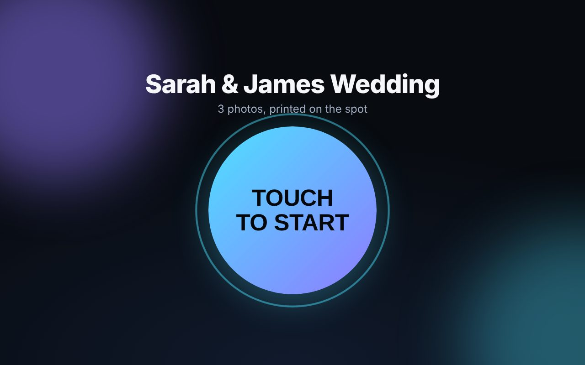

# Nexus Booth

A photobooth you run yourself: a touch-screen kiosk for guests, a DSLR for the photos, and a DNP printer for the prints.

```
guest taps  ->  countdown + live preview  ->  3 photos  ->  review / retake  ->  print  ->  thank you
```

It is a small local web app. A Node server drives the camera (through [digiCamControl](https://digicamcontrol.com), a free Windows program), builds the print layout, and sends it to the Windows print queue. The guest screen is just a browser in full-screen kiosk mode.

> **Read "[What has and hasn't been verified](#what-has-and-hasnt-been-verified)" before relying on this at a paid event.** The software is tested end to end, but the real DSLR and DNP printer paths could not be exercised outside your hardware.

## Try it in two minutes (no camera or printer needed)

Needs [Node.js 22 LTS](https://nodejs.org).

```bat
cd photobooth
npm install
copy config.example.json config.json     (macOS/Linux: cp config.example.json config.json)
npm start
```

Open <http://127.0.0.1:3000>. This uses a **mock camera** (synthetic photos) and **dry-run printing** (print PDFs are saved, nothing is printed), so you can rehearse the whole guest flow, the error screens and the operator panel.

Operator panel: tap the **top-left corner of the start screen 5 times**, or open `/operator.html`. Default PIN `1234` (change it).



## Set up your Windows booth PC

1. **Install Node.js 22 LTS.**
2. **Install digiCamControl** and plug in the DSLR over USB. Confirm that digiCamControl itself sees the camera and can take a photo before involving the booth.
3. **Turn on digiCamControl's web server** and allow it to run actions (its settings have a *Webserver* section; it is off by default, default port `5513`). Check it works: open `http://127.0.0.1:5513/?slc=list&param1=cameras` in a browser. You should see your camera's serial number. A web page instead of a serial number means actions are not enabled.
4. **Camera settings:** image quality **JPEG Large/Fine** (RAW-only is rejected with a clear message), turn **auto power-off/sleep off**, use an **AC adapter / dummy battery**, set a fixed exposure that suits your lighting/flash.
5. **DNP printer:** install the Windows driver and print a Windows test page. Then run `npm run printers` to list the exact **printer name** and the exact **paper size names** the driver offers. For photo strips use the driver's **2-inch cut / 2x6** size.
6. **Config:** `copy config.hardware.example.json config.json`, then edit `printer.name`, `printer.paperSize`, `operatorPin` and, if you like, `storage.dir`. Use a path **without spaces** such as `C:\booth\events`.
7. `npm install --omit=dev`, then double-click **`scripts\start-booth.bat`**. It starts the server and opens the guest screen full-screen in Chrome (or Edge). Put a shortcut to it in `shell:startup` to launch with Windows.

Leave kiosk mode with **Alt+F4**. To stop the booth, close the minimised "Nexus Booth server" window.

## Before every paid event: the checklist

Do this at home, with paper loaded, on the exact PC, camera and printer you will use. None of it can be done for you.

- [ ] Operator panel shows **Camera ready** and **Printer ready**, and no warnings you do not understand.
- [ ] **Take test photo** works and the picture is sharp and well exposed.
- [ ] **Print test page**: the red border is fully visible (nothing cropped), and the colour swatches look right.
- [ ] Run **3 full guest sessions** with the real layout. Check: the footer text renders, the strip cut falls *between* the two strips and does not slice a photo, the prints are the right way up.
- [ ] **Unplug the camera** mid-countdown. The guest should see the plain error screen, not a frozen page. Plug it back in and confirm "Try again" recovers.
- [ ] **Take the paper out** and run a session. Note what your printer does, because the booth cannot tell (see limitations). Know how you will notice a printer problem at the event.
- [ ] **Reboot the PC**, run `start-booth.bat` and confirm it comes up on its own.
- [ ] Run **20+ sessions back to back** and check nothing slows down or leaks.
- [ ] Change `operatorPin` and write the PIN down somewhere other than the booth.

## Running an event

- **Operator panel** (`/operator.html`, PIN): live camera/printer status, test photo, test print, recent print jobs, event settings, and recent sessions with a **Reprint** button.
- Change the **event name** there at the start of each event. It starts a new photo folder (`2026-10-16-sarah-james-wedding`) so events never mix.
- **Where the photos are:** `events/<event>/<session>/` holds `originals/` (the untouched camera files, including retakes), `final.jpg` (the print-resolution picture), `print.pdf` and `session.json`. Copy the whole `events` folder off at the end of the night.
- **Logs:** `logs/booth.log`.

## Layouts

| id | Photos | Output |
|---|---|---|
| `strip-2x6-x2` (default) | 3 | A 4x6 sheet holding **two identical 2x6 strips**. Use the printer's 2-inch-cut size and it cuts them apart. |
| `single-4x6` | 1 | One full-bleed 4x6 photo. |
| `duo-4x6` | 2 | Two photos stacked on a 4x6 portrait print. |

Switch layouts in the operator panel. **Your own layouts** are plain JSON in `templates/` (a file with a built-in id replaces that built-in). A branded layout is usually a PNG designed in Canva/Photoshop with **transparent windows where the photos show through**; the booth puts the photos underneath it.

```json
{
  "id": "wedding-strip",
  "name": "Wedding strip",
  "shots": 3,
  "canvas": { "width": 1200, "height": 1800, "dpi": 300, "background": "#ffffff" },
  "slots": [
    { "shot": 0, "x": 30,  "y": 40,  "width": 540, "height": 405 },
    { "shot": 1, "x": 30,  "y": 469, "width": 540, "height": 405 },
    { "shot": 2, "x": 30,  "y": 898, "width": 540, "height": 405 },
    { "shot": 0, "x": 630, "y": 40,  "width": 540, "height": 405 },
    { "shot": 1, "x": 630, "y": 469, "width": 540, "height": 405 },
    { "shot": 2, "x": 630, "y": 898, "width": 540, "height": 405 }
  ],
  "overlay": "wedding-strip.png",
  "text": [
    { "text": "{event}", "x": 300, "y": 1540, "size": 58, "weight": 700, "color": "#111111", "anchor": "middle", "maxWidth": 540 }
  ]
}
```

`overlay` is a PNG in `templates/` with exactly the canvas size. `{event}`, `{date}` and `{time}` are filled in. A layout with a mistake (a slot off the canvas, a photo no slot uses, a missing overlay) is skipped at startup with the reason shown in the operator panel; it never takes the booth down. Landscape canvases are rotated to fit the portrait-fed 4x6 sheet.

## Sharing: QR codes and guest galleries

Turn on `sharing.enabled` and every guest gets a **private web page with their photos**. A QR code for it appears on the screen while the print comes out (and stays on the thank-you screen), and is **printed on the photo** (on each strip, so both halves work after the 2-inch cut). Phones need no app.

| | `local` | `upload` |
|---|---|---|
| Where the gallery lives | on the booth PC | on your web host (see [`webhost/README.md`](webhost/README.md)) |
| Guest's phone needs | to be on the **same Wi-Fi** as the PC | normal mobile data or any Wi-Fi |
| Internet at the venue | not needed | **needed** (uploads queue and retry if it drops) |
| Best for | an event where you provide the Wi-Fi | most events |

```json
"sharing": { "enabled": true, "mode": "local", "wifiHint": "Join the Wi-Fi network NexusGuests first." }
```

**Local mode caveats.** Windows will ask to allow the booth through its firewall the first time (allow *Private* networks). Many venue and hotel Wi-Fi networks use *client isolation*, which stops phones from reaching your PC at all; bring your own router, or use `upload` mode. Only the galleries are exposed on the network (port `lan.port`, default 3001); the camera, printer and operator controls stay on this PC only.

**Upload mode caveats.** The QR printed on a photo points at your web host, so if the venue has no internet it will not open until the PC reconnects and the queue catches up (the operator panel shows what is waiting). Always test with real mobile data.

## Configuration

`config.json` is merged over the defaults in `server/config.js`; only the keys you set are needed. A typo is reported at startup, naming the setting, instead of failing at the event.

| Key | Meaning |
|---|---|
| `port`, `host` | Where the booth listens. `host` stays `127.0.0.1` so only this PC can reach it. |
| `operatorPin` | PIN for the operator panel. Change it. |
| `event.name` | Shown on the start screen and printed on the photos. |
| `activeTemplate` | Layout id (can be changed live in the operator panel). |
| `camera.driver` | `mock` or `digicamcontrol`. |
| `camera.digicamcontrol.*` | `baseUrl`, timeouts, `liveView`, `stopLiveViewForCapture` (most DSLRs cannot shoot full-resolution while live view runs). |
| `printer.mode` | `dryrun` (PDF only) or `windows` (real printing). |
| `printer.name` | Exact Windows printer name. **Required** for `windows` mode: the booth never falls back to your default printer. |
| `printer.paperSize` | Exact driver paper-size name, or empty to use the driver's own settings. |
| `printer.copies`, `enabled`, `autoPrint` | Copies per guest, printing on/off, print automatically when the review timer ends. |
| `ui.*` | Countdown length, how long each screen stays, retakes, mirrored preview, flash. |
| `storage.dir` | Where events are saved. |
| `sharing.enabled`, `sharing.mode` | Guest galleries and QR codes: `local` (served by this PC) or `upload` (your web host). |
| `sharing.publicBaseUrl` | The address phones use. Upload mode: `https://yourdomain.com/booth`. Local mode: leave empty to use this PC's network address. |
| `sharing.autoUpload`, `sharing.qrOnPrint` | Upload every session right away (needed for the printed QR to work); print a QR on layouts that have room. |
| `sharing.wifiHint`, `sharing.shareSeconds` | Text under the QR in local mode; how long the QR stays on the thank-you screen. |
| `sharing.upload.url`, `sharing.upload.secret` | Web host receiver address and shared secret (set the secret with the `BOOTH_UPLOAD_SECRET` environment variable). |
| `lan.host`, `lan.port` | The small network listener for galleries (default port 3001). Nothing else is exposed. |

## What has and hasn't been verified

**Verified, automatically, outside any hardware** (`npm test`, `npm run e2e`):

- Configuration, layout validation and pixel-level compositing (each photo lands in the right slot of both strips, EXIF rotation, overlays, text fitting).
- The print PDF is exactly 4x6 inches; landscape layouts rotate correctly.
- The whole HTTP API: guest journey, retakes, camera failure, a busy camera, operator PIN, settings, reprint.
- The guest and operator screens in a real browser (landscape and portrait), including the error screen and recovery.
- The digiCamControl adapter against a stand-in server that follows digiCamControl's own source code: command format, `OK`-vs-error replies, RAW rejection, timeouts, live view pause/resume.
- The Windows printing adapter against a stand-in for `pdf-to-printer`.
- Sharing: QR codes decoded back to the exact link, including a 0.6-inch code on a JPEG-compressed strip, each strip half after the cut, and the code shown on the kiosk screen opened in a phone-sized browser.
- The gallery listener exposes only galleries (the booth's API, operator panel and session folders are all unreachable from it).
- The web-host receiver (`webhost/upload.php`) running under **real PHP**: bad signatures, stale timestamps, path tricks, scripts disguised as images and oversized files are all refused; the queue retries, survives a restart and never publishes a gallery before its pictures.

**NOT verified: needs your hardware, so do the checklist above:**

- A real DSLR through a real digiCamControl: capture, live view, and live-view resume after each shot. The adapter mirrors digiCamControl's source, not a running copy.
- Real printing to a DNP printer, including the exact paper-size names and the 2-inch cut.
- Footer text rendering on Windows (it uses system fonts; a transparent PNG overlay with the text baked in avoids this entirely).
- `start-booth.bat` and kiosk mode on a real Windows PC.
- Scanning a **printed** QR with a real phone camera on DNP paper (decoding was tested on the digital picture with an independent QR reader).
- Local mode on a real venue network (Windows firewall prompt, client isolation, the phone actually reaching the PC).
- The web host's `.htaccess` rules (hiding `config.php`, blocking folder listings) and the host's own PHP settings; only the PHP script itself was tested. See the checks in `webhost/README.md`.

**Known limitations**

- **The booth cannot see printer problems.** "Done" means the job was handed to the Windows print queue. Out of paper, no ribbon or a jam are not reported back, so a guest can be told "sent to the printer" while nothing prints. Watch the printer and the Windows print queue.
- One camera, one photo at a time.
- Pausing live view around each shot adds a second or two before the preview returns.
- Not included yet: green screen, GIF/boomerang, QR/email/SMS sharing, multiple printers.

## Troubleshooting

| You see | Likely cause / fix |
|---|---|
| Operator: "Cannot reach digiCamControl" | digiCamControl is not running, or its web server is off or on another port. |
| Operator: "returned a web page instead of a command reply" | The web server is on but actions are not allowed. Enable them in digiCamControl. |
| "digiCamControl is running, but no camera is connected" | Check the USB cable, camera power and that the camera is not in sleep. |
| Preview stays black but photos still work | Live view is not running or not supported by that camera/mode. Set `camera.digicamcontrol.liveView` to `false` to run without a preview, or check live view works inside digiCamControl itself. |
| "The camera saved a RAW file" | Set the camera to JPEG Large/Fine. |
| "no photo file appeared in ..." | Check `storage.dir` has no spaces, and that digiCamControl can write there. |
| Operator: "Printer ... not found" | Run `npm run printers` and copy the name exactly. |
| Operator: paper size "... is not one of its sizes" | Copy the size name exactly from `npm run printers`. |
| Strip cut slices through a photo | The driver is not on its 2-inch-cut paper size; set `printer.paperSize`. |
| Prints are cropped or have white edges | Check `printer.scale` (`fit` / `noscale`) and the driver's borderless setting. |
| Footer text is missing or shows boxes | System fonts unavailable: use a PNG overlay with the text baked in. |
| Port already in use | Another copy of the booth is running. Close it, or change `port`. |

## Development

```bat
npm test        # unit and API tests
npm run e2e     # drives the real UI in a browser and refreshes docs/screens/
```

`server/` is the booth (`camera/` holds the mock and digiCamControl drivers, `compose.js` builds the print image, `print.js` / `printQueue.js` handle printing), `public/` is the guest and operator UI, `templates/` is for your layouts.
